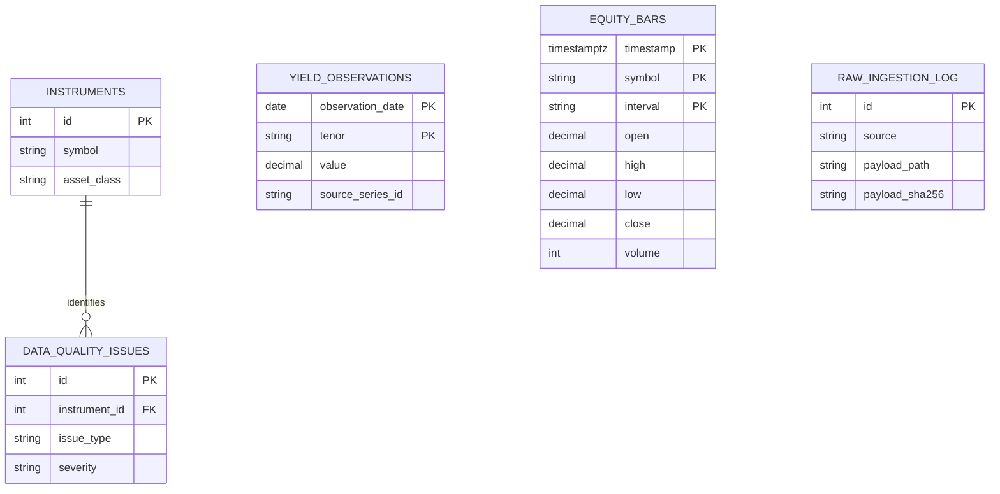

# Fixed Income & Equity Market Monitor

A full-stack portfolio project for monitoring US Treasury yields and ETF market data. It uses PostgreSQL for time-series storage, FastAPI for analytics and streaming APIs, and a React dashboard.

## Phase 1: database design



### Why this schema

- **Long-form yields:** one row per `date` and `tenor` lets the API request a curve, a single-tenor history, or add tenors without a schema migration. A wide table is convenient for a single curve query but turns every new tenor into a migration and complicates metadata.
- **Normalized instrument metadata:** equity identities live in `instruments`; observations retain their market-native identifiers (`symbol`, FRED `series_id`) to keep ingestion and query paths simple.
- **Relational PostgreSQL:** transactional upserts, constraints, and indexes make data-quality checks dependable. The expected project volume does not justify a NoSQL model, which would shift those safeguards into application code.
- **Plain PostgreSQL first:** the composite primary keys and query indexes are portable to RDS. TimescaleDB would be useful at a much larger tick-data scale, but adds an extension and deployment dependency before it is needed.
- **Raw audit trail:** every later ingestion writes a local raw payload and records its digest, status, and path. This supports reproducible transforms and investigation of bad records.

### Schema invariants

| Table | Key / index | Purpose |
|---|---|---|
| `yield_observations` | PK `(observation_date, tenor)`, index `(tenor, observation_date)` | One daily value per Treasury tenor; `NULL` values preserve FRED holiday/missing observations without treating them as zero. |
| `equity_bars` | PK `(timestamp, symbol, interval)`, index `(symbol, timestamp)` | One OHLCV bar at each supported interval; constraints reject invalid OHLC ranges and negative volume. |
| `raw_ingestion_log` | source and count constraints | Tracks the exact unmodified response stored before transformation. |
| `data_quality_issues` | open-issue index | Records missing-date, stale-feed, and outlier checks for later API and dashboard use. |

## Local setup

1. Install Docker Desktop, then confirm `docker version` works in your terminal. This environment currently does not expose the Docker CLI, so database startup must be run from your local terminal after it is available.
2. Copy the template without committing credentials:

   ```bash
   cp .env.example .env
   ```

3. Replace the two API-key placeholders in `.env` with **newly rotated** keys. `.env` is ignored by Git.
4. Create a Python virtual environment and install the backend:

   ```bash
   cd backend
   python3 -m venv .venv
   source .venv/bin/activate
   pip install -e ".[dev]"
   ```

5. From the repository root, start PostgreSQL and apply the migration:

   ```bash
   docker compose up -d postgres
   cd backend
   alembic upgrade head
   pytest
   ```

6. Inspect the created schema:

   ```bash
   cd ..
   docker compose exec postgres psql -U market_monitor -d market_monitor -c '\dt'
   ```

## Provider verification before Phase 2

Run these only from your local terminal after setting a rotated key in `.env`; do not paste a key into source or chat.

```bash
set -a; source .env; set +a

# FRED: expected JSON has an "observations" array; values can be "." for non-business days.
curl --fail --silent --show-error \
  "https://api.stlouisfed.org/fred/series/observations?series_id=DGS10&api_key=$FRED_API_KEY&file_type=json&observation_start=2015-01-01" \
  | jq '{count: (.observations | length), first: .observations[0]}'

# Finnhub REST: expected JSON contains c/current, d/change, dp/percent change, h/l/o, pc, and t.
curl --fail --silent --show-error \
  "https://finnhub.io/api/v1/quote?symbol=SPY&token=$FINNHUB_API_KEY" | jq .

# Finnhub WebSocket: expected messages have type "trade" and data entries with p, s, t, and v.
python3 - <<'PY'
import asyncio, json, os
import websockets
async def main():
    async with websockets.connect(f"wss://ws.finnhub.io?token={os.environ['FINNHUB_API_KEY']}") as ws:
        await ws.send(json.dumps({"type": "subscribe", "symbol": "SPY"}))
        print(await asyncio.wait_for(ws.recv(), timeout=30))
asyncio.run(main())
PY
```

## Phase 2: ingestion and data quality

- `app.ingestion.FredClient` uses `FRED_API_KEY` from the process environment and retries
  transient provider failures with exponential backoff. It preserves FRED `"."` values as SQL
  `NULL`.
- `YFinanceClient` is behind an equity-provider interface and requests daily history beginning
  on **2015-01-01**. Both providers return normalized records without directly accessing the
  database.
- `IngestionService` archives unmodified provider payloads under `data/raw/<source>/`, logs
  their digest in `raw_ingestion_log`, and uses PostgreSQL `ON CONFLICT DO UPDATE` upserts for
  yield observations and equity bars.
- `app.ingestion.quality` persists missing NYSE trading dates, stale feeds, and z-score
  outliers in `data_quality_issues`. Callers provide the relevant instrument ID and observations
  after each ingestion transaction.

All provider tests use mocked HTTP/ticker inputs; no external provider call is made by `pytest`.

## Planned phases

1. Database design and migrations (complete)
2. Idempotent ingestion, raw archives, data-quality checks, and tests
3. Analytics and FastAPI endpoints
4. Finnhub streaming and client broadcasts
5. React dashboard
6. AWS deployment
7. CI, documentation, and interview talking points
